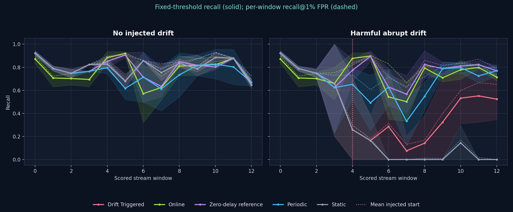
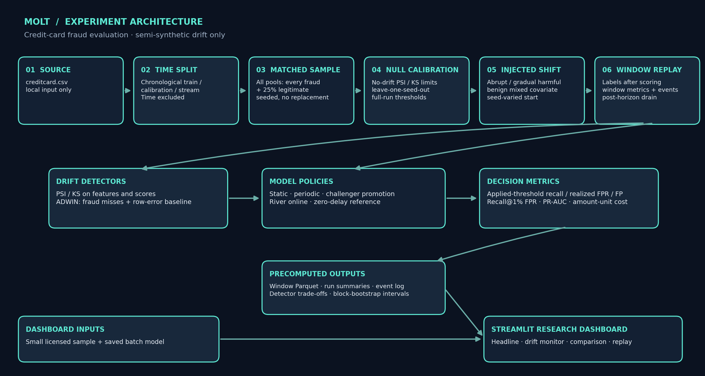

# MOLT: full protocol and result detail

The long version of the README: experiment protocol, detector and policy details, uncertainty notes and the latest result snapshot. The short README is in the project root.

## Summary

MOLT is a fraud-detection concept-drift benchmark. It replays real, anonymized credit-card transactions as a sampled stream, injects controlled semi-synthetic drift (not naturally occurring drift), and compares strategies for keeping a fraud model current. A fraud-miss ADWIN detector (δ = 0.002) watches delayed labels; when it signals, MOLT trains a challenger and promotes it only if it improves on the champion on a separate held-out window at a matched 1% FPR target.

For harmful abrupt drift (intensity 1.0, one-window label delay; five seeds), **recall@1% FPR** was:

| Strategy | Recall@1% FPR |
|---|---:|
| Static | 0.29 |
| Drift-triggered (MOLT) | 0.50 |
| Periodic retraining | 0.76 |
| River online | 0.79 |
| Zero-delay retraining reference | 0.80 |

- Static loses the most recall. Drift-triggered adaptation recovers about 41% of the gap from static to the zero-delay reference. Its paired recall@1% FPR difference versus static is +0.209 (95% paired block interval [+0.103, +0.324]), above zero in this benchmark.
- Periodic retraining is ahead of drift-triggered adaptation in this setup: drift-triggered minus periodic is −0.256 (interval [−0.353, −0.163]). Fraud-miss ADWIN detection takes 3.4 windows on average—about 13,600 sampled transactions at 4,000 rows per window—and label delay adds to the time before adaptation can use feedback.
- Drift-triggered MOLT retrains zero times in the benign-shift and no-drift controls; periodic retraining averages four retrains per run in both.
- Fraud-miss ADWIN detected harmful abrupt drift in 5/5 drift-triggered runs and had no false alarms across 25 no-drift seed-strategy runs. PSI and KS are diagnostics only: in drift-triggered runs each missed 60% of harmful-abrupt cases; across strategies their miss rates ranged from 20% to 80%. Among detected drift-triggered cases, mean delay was 6.5 windows for PSI and 6.0 for KS.

**Limits:** drift is injected rather than naturally observed; the stream's fraud prevalence is elevated by retaining all frauds and sampling 25% of legitimate rows; seeds resample only legitimate rows, not independent datasets; some windows contain few frauds. These are benchmark results, not real-world evidence. The paired intervals are exploratory, based on five seed clusters, and unadjusted for multiple comparisons.

MOLT is an educational research workbench for imbalanced credit-card fraud classification and **semi-synthetic** drift experiments. It uses the anonymized ULB/Worldline credit-card dataset distributed through Kaggle. It is not connected to a bank, card processor, or live payment feed, and it is not suitable for financial decisions.



The plot contrasts a no-drift control with a controlled harmful-abrupt injection. Solid curves show recall at the threshold applied to that strategy; dashed curves show the separate ranking metric recall at a per-window false-positive-rate ceiling. Shading summarizes seed variation. See the generated detector table and diagnosis files under `results/` for measured outcomes; the project reports negative findings rather than asserting that adaptation succeeded.

## Architecture



Rendered with [`docs/render_architecture.py`](render_architecture.py); editable Mermaid source: [`docs/architecture.mmd`](architecture.mmd).

## Experiment protocol

The raw data is sorted chronologically by `Time`; equal-time transactions stay together at temporal split boundaries. The batch analyzer uses a non-shuffled 60% train / 20% validation / 20% test split. Model inputs are V1–V28 and `Amount`; `Time` is ordering metadata and `Class` is the label. Its operating threshold is chosen on validation data at a maximum 1% FPR, then applied once to the later test period.

The adaptation stream uses 4,000-row windows. If its final remainder is below half the target size, that remainder is merged into the preceding window using row counts only; window construction never consults labels.

The adaptation experiment creates early initial-training and calibration pools and a later stream. It retains every fraud row and samples legitimate transactions without replacement at the same 25% rate in **all three pools**, using seed-specific random sampling. This aligns the sampling-induced class mixture in the PSI/KS reference and stream, while raising fraud prevalence relative to the original dataset. Precision, realized FPR and amount-based costs are therefore conditional on this sampled stream, not the original transaction population. Every run reports fraud counts per window.

The controlled injections are:

- **Harmful abrupt / gradual:** fraud rows move toward legitimate reference medians on features ranked as important by the initial Logistic Regression model; the gradual case ramps over time.
- **Benign mixed covariate shift:** labels remain unchanged while `Amount` and several important V features shift for both classes. “Benign” describes the label-preserving construction, not a guarantee that model performance is unaffected.
- **No-drift control:** unchanged later-period rows used to calibrate detector signal thresholds.

The injected start is varied deterministically across seeds and recorded per run. This is still a controlled, semi-synthetic benchmark—not a claim that naturally occurring drift was detected.

## Detectors and adaptation policies

ADWIN (delta = 0.002) monitors delayed fraud misses and is the **only signal that triggers adaptation**. The transaction-level prediction-error ADWIN is reported only for the static comparator. PSI and KS are secondary diagnostics: feature PSI uses the mean of the three largest feature values, and KS alarms use the D statistic rather than unstable p-values. Score diagnostics compare each active model's scores on the same fixed calibration cohort with current-window scores; stream windows never refresh the reference. PSI/KS limits are calibrated separately for each strategy from leave-one-seed-out no-drift runs, with two consecutive windows required. The fraud-only ADWIN stream has fewer observations, so its false-alarm rate and delay are reported. `--quick` calibrates on its single seed and is only a smoke test, not an independent false-alarm estimate.

When fraud-miss ADWIN warns, the drift-triggered policy can fit a challenger from released labels. The champion and challenger thresholds are both calibrated to the same 1% FPR target on one calibration window, then compared on a separate holdout window. The candidate must satisfy the calibration-FPR gate and reduce holdout fraud misses; holdout FPR is recorded as a diagnostic, not used as an extra hard rejection rule. Holdout windows are not reused for subsequent attempts. All warning, confirmation, promotion, rejection, and detector events are logged; a warning or challenger is not evidence of successful adaptation.

Strategies are static, periodic retraining, drift-triggered challenger promotion, River online learning, and an **immediate-label retraining reference** (“oracle”). Retraining policies use recent available labels and a shared fixed-FPR recalibration routine; the newest labeled window is held out for recalibration where applicable. Training data is capped/recency-limited. A strict “upper bound” would require hindsight model/policy selection or evaluation-label access, which would violate the no-test-leakage rule. The oracle is therefore a zero-delay reference, not a claimed mathematical upper bound; any strategy beating it is investigated and reported rather than hidden.

Each scored window records both:

- **Recall at the applied threshold, realized FPR and false-positive count:** the outcomes of actual decisions made with the threshold available at scoring time.
- **Recall@1% FPR:** a separate ranking comparison whose operating point is computed from that evaluation window. It is not the recall of the applied decision threshold.

Labels from a scored window never affect predictions in that same window, even for zero-delay runs; zero delay means labels are released after the window has been scored. The simulator records the source prediction window and feedback-arrival window separately. End-of-stream detections are reported as post-horizon events, not silently folded into the final scored window.

## Uncertainty and interpretation

The configured seeds resample legitimate rows; they do not create independent datasets or establish population-level confidence. Headline shading summarizes seed-to-seed variation. `results/block_bootstrap.csv` contains per-strategy descriptive moving-block intervals; `results/paired_block_bootstrap_differences.csv` reports paired strategy differences with seed-clustered moving-block intervals. Five seeds are a small benchmark scope, so neither interval is population-level certainty. The underlying dataset covers a short period and has limited fraud examples, so per-window rates can be unstable. PCA features are anonymized, and the experiment cannot infer specific attacker or customer behavior.

Costs sum the `Amount` of missed fraud plus an assumed review fee of five dataset amount units per alert. They are relative dataset-based proxies—not rupees, measured losses, or realized savings. Detector alarms are investigation signals, not fraud labels.

## Latest regenerated result snapshot

The regenerated artifacts contain five seeds, five scenarios, and five strategies (125 runs and 1,625 scored windows). Under **harmful abrupt drift, intensity 1.0, one-window label delay**, the mean outcomes were:

| Strategy | Recall at applied threshold | Realized FPR | Recall@1% FPR |
|---|---:|---:|---:|
| Static | 0.283 | 0.008 | 0.293 |
| Periodic | 0.678 | 0.005 | 0.758 |
| Drift-triggered | 0.460 | 0.007 | 0.502 |
| River online | 0.735 | 0.012 | 0.792 |
| Zero-delay reference | 0.766 | 0.006 | 0.803 |

Drift-triggered promotion occurred five times across the five runs, but its average applied-threshold recall remained below periodic, online, and the zero-delay reference. Paired threshold-recall differences (drift-triggered minus comparator) were +0.176 versus static, −0.218 versus periodic, −0.275 versus online, and −0.307 versus the zero-delay reference; the corresponding 95% paired block intervals are in `results/paired_block_bootstrap_differences.csv`. Those intervals resample five seed clusters and contiguous windows, are exploratory and unadjusted for multiple comparisons, and do not generalize beyond this benchmark.

In the no-drift control, strategy-specific run-level PSI false-alarm rates ranged from 0% to 20%, and KS-statistic rates ranged from 20% to 40%. Fraud-miss ADWIN had no false-alarm runs among 25 seed-strategy runs; the static-only row-error ADWIN baseline had none among five runs. Under harmful abrupt drift, fraud-miss ADWIN detected in all five drift-triggered runs with a mean delay of 3.4 windows. PSI and KS remain diagnostic, not adaptation triggers. Detailed outcomes and event logs are in [`results/experiment_findings.md`](../results/experiment_findings.md), [`results/detector_tradeoffs.csv`](../results/detector_tradeoffs.csv), and [`results/drift_triggered_diagnosis.csv`](../results/drift_triggered_diagnosis.csv).

## Data and licensing

Download the dataset separately from [Kaggle: Credit Card Fraud Detection](https://www.kaggle.com/datasets/mlg-ulb/creditcardfraud), review the dataset terms, and place the raw file at `data/raw/creditcard.csv` for training and experiment regeneration. The full raw CSV is intentionally not included in Git or this ZIP.

The Kaggle listing reports the database under ODbL 1.0 and contents under DbCL 1.0. The dashboard sample is kept in the tracked `app_data/creditcard_sample.parquet`; it includes all fraud rows and a seeded subset of legitimate examples. See [`DATA_LICENSE.md`](../DATA_LICENSE.md) for attribution and source/license links. Regeneration writes a replacement sample there.

## Install, run, and test

Use Python 3.10. On Windows, create and activate the environment in PowerShell:

```bash
py -3.10 -m venv .venv
.\.venv\Scripts\Activate.ps1
```

In Windows Command Prompt, activate with `.venv\Scripts\activate.bat`. On macOS/Linux:

```bash
python3.10 -m venv .venv
source .venv/bin/activate
```

Then install dependencies and run tests:

```bash
python -m pip install -r requirements.txt
python -m pip install -r requirements-dev.txt
pytest -q
```

The dashboard does not need the raw CSV; it reads tracked `app_data/`, saved model artifacts, and precomputed `results/` files. Start it with:

```bash
streamlit run app.py
```

For Streamlit Community Cloud, choose the repository and `app.py` as the entry point, then select **Python 3.10** in the app’s advanced settings. The deployment does not depend on `runtime.txt`.

To regenerate the saved batch model and validation threshold, place the raw CSV at the path above and run:

```bash
python threshold_analysis.py
```

Run the one-seed end-to-end smoke test with:

```bash
python -m experiments.run_all --quick
```

Run the full repeated experiment suite (multiple seeds, held-out no-drift detector calibration, all strategies and scenarios) with:

```bash
python -m experiments.run_all
python -m experiments.diagnose_drift_triggered
```

The runner writes the window-level Parquet, run/strategy summaries, per-detector false-alarm and delay table, drift-triggered diagnosis CSV, generated findings note, block-bootstrap intervals, updated dashboard sample, and side-by-side plot under `results/` and `app_data/`. Full regeneration takes substantially longer than the smoke test.

## Responsible use

MOLT is a research prototype for comparing specified policies under one dataset and controlled injections. It does not demonstrate production readiness or successful adaptation to naturally occurring drift. Before any real use, independent datasets, prospective evaluation, careful calibration, privacy/security review, human oversight, and operational controls would be necessary.
